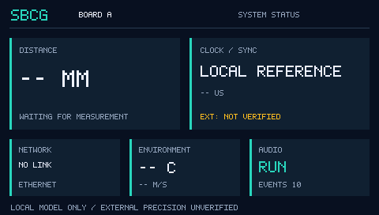

# U0 RGB565状态页：软件准备完成，硬件接入待CubeMX

<!-- doc-status: completed-software-awaiting-display-hardware; reviewed: 2026-10-24 -->

用户要求修复问题后推进显示，并明确先LTDC RGB565、后TouchGFX；参考指定聊天及GUI_FOR_TEST。M4.1.3本地模型/日志修复已先提交1d4dfde，本增量只做显示的软件准备，没有开启第二个并行硬件里程碑。

## 已交付

- App/UI/status_view.c/.h：带单位/valid/captured_ms的快照→有界ASCII文本。未知/无效/超龄不是0，外部精度始终未验证；纯数据层可供未来TouchGFX复用。
- App/UI/rgb565_canvas.c/.h：调用方内存的RGB565布局检查、裁剪矩形、5x7 ASCII字体，保护stride填充和行带，无固定SDRAM地址/动态分配。
- App/UI/status_screen.c/.h：480x272状态页，距离/同步/网络/温度声速/音频事件；支持分行渲染，未测距显示-- MM。
- Tests/UI/test_status.c、run_tests.py：真实C测试与直接从RGB565输出导出PNG，无图片编辑或外部字体依赖。
- Docs/Assets/status_rgb565_preview.png：离线页面预览。
- Docs/Plans/2026-10-24_LTDC_RGB565_Bringup.md：逐项CubeMX入口、硬件顺序、参考差异与移植限制；Hardware_Resources相关时序纠错并指向该现行方案。

预览使用受控快照示例（A、无网线、温度无效、音频RUN/10事件）；不是实时业务连接或实板屏幕照片。首版ASCII用于验证显示链路，后续TouchGFX再加入中文字体/触控交互。

同步刷新Docs/Project_State.md、Docs/README.md、Docs/Document_Status.md、Docs/Project_Roadmap.md及根README.md；补登记既有PPS报告/历史计划用于资源追溯，PPS源码/生成配置仍单独保留。

## 调用链和验证

`主机测试 → UI_CanvasInit → UI_StatusRenderRows → UI_StatusFormat / UI_FillRect / UI_DrawText`。数据只来自调用方副本，不访问HAL、网络或音频DMA。未来由UI适配器收集业务快照，再交由视图绘制；本次未创建适配器或虚构接线。

`python -B Tests/UI/run_tests.py --preview Docs/Assets/status_rgb565_preview.png`通过：未知/无效/2秒陈旧、负温和INT32/INT64边界、tick回绕、RGB565红绿蓝白、矩形极端坐标裁剪、stride填充保护、帧前后canary、16行分片与整屏字节一致、错误行带拒绝。先观察缺失行为失败，再实现；主机GCC以-Wall/-Wextra/-Werror/-pedantic检查。

软件增量不注册固件源列表；已有Debug/Release构建和原布局保持，新UI没有烧录、运行或绘制到板上。没有新IRQ或DMA关系。I/D Cache保持关闭，不加维护调用；UI内核不知道0xC0000000地址，因此不会在SDRAM初始化之前越过MPU。

## 当前硬件关口

当前SBCG无FMC/LTDC初始化，Region0禁止访问SDRAM。依据根AGENTS.md第4节，必须通过CubeMX新增配置并Generate Code后，才能检查生成结果并接BSP。**CubeMX change required**；本轮未编辑.ioc或生成区。

下一独立目标是U1 SDRAM：只配置FMC SDRAM1及8MB MPU Region1，HCLK保持200MHz、SDCLK/3约66.667MHz、CAS3；先验命令序列/内存与原音频零丢块，再开启LTDC。完整38脚与MPU表见现行方案。LCD时序以后采用水平41/13/32、垂直10/2/2、9.6MHz与RGB565；旧H1/43/8、V10/12/4已撤销，参考GUI的216MHz/72MHz/1105刷新值不照搬。

无屏幕实物通过、TouchGFX、触控、DMA2D或同步精度结论。下一步等待用户按方案在CubeMX只生成FMC/MPU；不能由应用初始化绕过这一关口。
