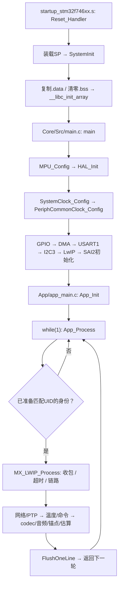
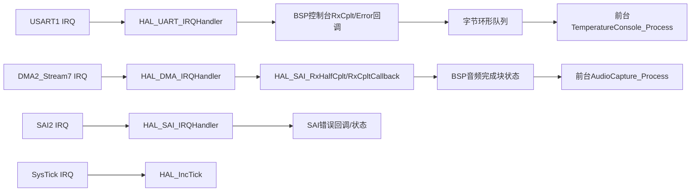

# SBCG 当前系统架构与真实运行流程

<!-- doc-status: current-architecture; reviewed: 2026-10-23 -->

本文依据当前源码、CMake登记、Debug编译数据库和M3.2.4实物记录整理。它是当前系统的阅读地图，历史计划不再按顺序重复执行。当前源码和A实物版本为M2.3.1/SBCG-M2.3-ROLE，UID身份及原业务已通过123秒联合验收；B待用户更新/验收。原M3.2.4采集/时间模型链路保留。当前进度统一见[Project_State](Project_State.md)。

## A. 架构总结：硬件生成层、应用服务层与主机验证层

**App承担大部分自有应用逻辑；App之外大量代码也是正式运行的必要组成部分。** 启动汇编建立C运行环境，Core完成硬件初始化与IRQ转发，HAL操作外设，LwIP处理网络协议；这些都不是测试代码。`Tests/`、`Tools/Monitor/`、`Analysis/`才分别承担主机回归、采集和离线核对。

当前是**单核、无RTOS的前台主循环＋硬件中断交接**。没有TouchGFX目录/Designer生成层、Presenter/View/Model，也没有GUI任务、触控事件处理或LCD绘制调用。LTDC、DMA2D、FMC/SDRAM均未启用；板上有显示屏不代表本固件已经驱动了它。

### 目录与文件职责

| 目录或文件 | 实际作用与证据 | 是否参与MCU正式运行 | 工具生成/来源 | 业务逻辑 |
| --- | --- | --- | --- | --- |
| `startup_stm32f746xx.s` | 向量表、Reset_Handler、C环境准备并调用main；生成CMake登记 | 是 | 芯片启动模板/生成资源 | 否，启动机制 |
| `Core/Src/main.c` | MPU、HAL、时钟、GPIO/DMA/UART/I2C/LwIP/SAI，调用App_Init/Process | 是 | CubeMX；App调用保存在USER CODE区 | 主要是启动与硬件配置 |
| `Core/Src/system_stm32f7xx.c` | SystemInit、系统时钟变量等CMSIS设备支持 | 是 | ST模板 | 否 |
| `Core/Src/stm32f7xx_hal_msp.c` | HAL初始化时配置外设引脚、时钟、DMA与NVIC | 是 | CubeMX | 否 |
| `Core/Src/stm32f7xx_it.c` | SysTick及UART/SAI/DMA IRQ入口转交HAL | 是 | CubeMX | 否，异步入口 |
| `Core/Src/sysmem.c`、`syscalls.c` | newlib内存/系统调用适配；按实际链接使用 | 是，相关符号按需链接 | 生成模板 | 否 |
| `Core/Inc/` | HAL配置、板级引脚与中断声明 | 编译依赖 | CubeMX/ST模板 | 否 |
| `Drivers/CMSIS/` | Cortex-M7/芯片寄存器、核心指令和设备定义 | 编译和运行依赖 | ST/Arm库 | 否 |
| `Drivers/STM32F7xx_HAL_Driver/` | UART/I2C/ETH/SAI/DMA/RCC等HAL实现 | 被登记并实际调用的部分参与 | ST驱动库 | 否，底层实现 |
| `Drivers/BSP/Components/lan8742/` | 通过MDIO管理PHY及协商状态；生成CMake登记 | 是 | ST器件驱动 | 否 |
| `LWIP/App/lwip.c` | gnetif初始化、静态地址、主循环网络处理 | 是 | CubeMX | 集成胶水 |
| `LWIP/Target/ethernetif.c` | ETH句柄/描述符/RX池、HAL与pbuf转换及链路处理 | 是 | CubeMX＋已有安全USER CODE扩展 | 集成胶水 |
| `LWIP/Target/lwipopts.h` | NO_SYS=1、TCP关闭、内存/接口选项 | 编译配置影响运行 | CubeMX | 否 |
| `Middlewares/Third_Party/LwIP/` | ARP/IPv4/ICMP/UDP、内存池、超时和网络接口实现 | 是，实际启用路径参与 | 第三方中间件 | 否，通用协议栈 |
| `App/app_main.c/.h` | 服务初始化/轮询顺序、BOOT/心跳、有界日志队列 | 是 | 自有代码 | 是，协调层 |
| `App/BSP/` | UID角色/IP/MAC选择、console、DHT、ETH/PTP、codec/音频资源封装 | 是 | 自有代码 | 硬件抽象，不替代CubeMX配置 |
| `App/Network/` | 链路观测、UDP心跳、请求应答和时间戳交换 | 是 | 自有代码 | 是 |
| `App/Sync/` | 本地PTP观测、收发关联、四时刻整数估算 | 是 | 自有代码 | 是；尚未闭环校时 |
| `App/Temperature/` | DHT帧校验、温度状态/手动覆盖、整数声速 | 是 | 自有代码 | 是 |
| `App/Console/` | 将UART字节流解析为温度命令 | 是 | 自有代码 | 是 |
| `App/Audio/` | codec观测、DMA块统计/编号、本地锚点、三点时间模型自检 | 是 | 自有代码 | 是；尚无声音事件检测 |
| `CMakeLists.txt` | 创建SBCG目标，登记App，关联生成层/用户扩展 | 构建时使用，配置决定ELF | 首次生成后允许用户维护，现含自有集成 | 否 |
| `cmake/stm32cubemx/` | 登记Core、启动、HAL和LwIP源码及宏/包含路径 | 构建时使用 | CubeMX | 否 |
| `cmake/audio-layout.cmake`、`ethernet-layout.cmake` | 再生成安全的用户集成、宏、内存布局约束 | 构建/链接时使用 | 自有扩展 | 否 |
| `STM32F746xx_FLASH.ld`、`cmake/linker/` | Flash/RAM区段、音频/ETH保留区、堆栈边界与链接断言 | 决定运行地址，脚本本身不执行 | 生成主脚本＋自有扩展 | 否，但不可缺少 |
| `SBCG.ioc`、`.mxproject` | CubeMX配置真源与项目生成元数据 | 代码生成时使用，非运行时读取 | CubeMX | 否 |
| `CMakePresets.json`、工具链文件 | Debug/Release、Ninja、ARM编译/链接参数 | 构建时使用 | 工程配置 | 否 |
| `.vscode/`、`setup-vscode.ps1` | 编辑器、任务、OpenOCD调试与环境辅助 | 电脑开发时使用 | 项目配置/脚本 | 否 |
| `Tests/` | 主机C测试及HAL/LwIP桩；不登记到SBCG固件 | 否 | 自有测试 | 验证逻辑 |
| `Tools/Monitor/` | 构建诊断、串口/UDP采集、布局检查 | 电脑运行 | 自有工具 | 开发/验收 |
| `Analysis/` | 真实C参考、Fraction、日志完整性及离线核对 | 电脑运行，部分C参考复用算法 | 自有工具 | 验证逻辑 |
| `Docs/`、`Logs/` | 设计/实物结论与本机原始证据；Logs被忽略 | 否 | 人工维护/采集生成 | 否 |
| `.github/` | 协作模板、主机测试工作流、README横幅SVG | 仅网页/CI；不入固件 | 自有文档/配置 | 否 |
| `build/`、`compile_commands.json` | CMake/Ninja输出、ELF/map/obj、索引元数据 | ELF可烧入；目录不是源码 | 构建生成 | 否 |

当前Debug数据库共139个编译单元：App30、Core6、LWIP2、Drivers20、Middlewares80、启动汇编1。**62个App C/H是30个源文件＋32个头文件**；头文件不是单独编译单元。LwIP的生成源码列表较宽，出现PPP/TCP源码不代表当前启用了它们：`LWIP_TCP=0`，具体分支受宏和链接垃圾回收控制。

原有项目图片资产`.github/assets/sbcg-banner.svg`用于GitHub说明；本轮新增Docs/Diagrams下的架构示意图仅用于文档，两者均不进入LCD帧缓冲或GUI资源。不存在当前固件需要加载的字体、TouchGFX图片或界面资源。

### 删除影响：区分“运行必需”与“开发必需”

删除启动、Core、HAL、启用的LwIP、App源或链接脚本会破坏现有构建/符号/硬件工作流程；删除某些未启用库文件的结果必须逐项确认，不能断言Drivers中每个文件均被运行。删除Tests/Tools/Analysis一般不会改变已烧录固件，但会损失回归/采集/验收能力。删除.ioc不会让已烧录板立即停止，却会失去硬件配置真源和可靠再生成能力。删除GUI相关代码在当前工程无从谈起，因为这些模块尚不存在。

## B. 从复位到持续输出的真实流程

### 启动链

启动文件的实际顺序是**先SystemInit，再准备.data/.bss，再调用C库初始化和main**；SystemInit不等于后面的200MHz系统时钟配置。`main`中MPU在HAL前配置。HAL外设初始化还会调用MSP函数，这些回调负责时钟、复用引脚、DMA链接和IRQ配置。ETH初始化在`MX_LWIP_Init → netif_add → ethernetif_init → low_level_init`内发生，不应凭经验给main虚构一个独立MX_ETH_Init调用。

新增启动路径：MX_LWIP_Init的IP_ADDRESSES用户区→BSP_BoardIdentity_ConfigureIp→BoardIdentity_Resolve；未知UID在lwip_init前返回。有效身份在ethernetif的MACADDRESS用户区复制MAC再进入HAL_ETH_Init。App_Init读取同一缓存并核对BOOT UID，输出BOARD；失败则不启动业务，App_Process也不调用LwIP。B仍调用原温度服务初始化，但其UID允许名单会禁用本地DHT读取。

可编辑简图及SVG保留M3.2.4时的服务流程，尚未绘入身份门控；当前详细调用以上述说明、Mermaid和源码为准。见[启动流程图](Diagrams/system_runtime.drawio)、[SVG预览](Diagrams/system_runtime.svg)。详细顺序以上方Mermaid及源码为准。

### App_Init的一次初始化顺序

| 顺序 | 真实调用 | 依赖与作用 |
| --- | --- | --- |
| 1 | UDPTimeExchange_Deinit | 再初始化时先撤外层网络包装；所有权冲突则返回，避免覆盖未知钩子 |
| 2 | BSP_Console_GetInfo、SendLine | 清状态/日志队列，读取HCLK/UID，发BOOT；生成层已准备UART |
| 2a | BSP_BoardIdentity_Get、EmitBoardIdentity | 核对已准备身份及真实UID，输出BOARD；未知则返回，不执行下列服务 |
| 3 | EthernetMonitor_Init | 取得PHY与链路观测基线 |
| 4 | UDPHeartbeat_Init、UDPProbe_Init | 建立周期UDP与请求/应答服务 |
| 5 | PtpClock_Init、PtpRx_Init、PtpTx_Init | 本地PTP配置/观察及旧服务硬件戳包装 |
| 6 | SyncObservation_Init、UDPTimeExchange_Init | 初始化整数估算观测，最后安装时间交换外层包装 |
| 7 | TemperatureService_Init、TemperatureConsole_Init | 初始化DHT状态、声速与命令解析器 |
| 8 | AudioCapture_Init | 配置codec业务寄存器并启动既有SAI/DMA采集资源，不重配DMA映射 |
| 9 | AudioTimeAnchor_Init、AudioTimeMapMonitor_Init | 建立游标/PTP锚点及三点自检窗口 |
| 10 | CodecMonitor_Init、BSP_Console_RxInit | 初始化ID观测，开启UART单字节中断接收 |
| 11 | FlushOneLine | 尝试排空一条延后日志 |

以上LwIP/音频条目受当前构建宏控制，不假设所有历史组合均执行同样调用。`App_Init`是应用协调入口，`main`是C程序入口，硬件复位入口则是Reset_Handler；三者不是同一个层级。

### App_Process每轮顺序与节流

| 顺序 | 真实调用/段落 | 执行方式 |
| --- | --- | --- |
| 0 | app_identity_configured | 未配置身份立即返回，不触碰尚未初始化的网络和业务 |
| 1 | MX_LWIP_Process | 每轮先轮询收包、sys_check_timeouts和链路 |
| 2 | UDPHeartbeat_Process、串口HEARTBEAT段 | 各按毫秒差值节流；延误后跳过旧周期，不突发补发 |
| 3 | EthernetMonitor_Process | 链路状态/周期报告 |
| 4 | UDPProbe_Process | 原请求应答服务状态观测 |
| 5 | PtpClock_Process、PtpRx_Process、PtpTx_Process | 本地时钟及收发硬件戳队列/日志处理 |
| 6 | UDPTimeExchange_Process、SyncObservation_Process | 新时间交换/REPORT和观测提交后的整数估算 |
| 7 | TemperatureService_Process | 推进AUTO/手动温度与DHT起始/读取状态 |
| 8 | TemperatureConsole_Process | 消费UART字节，处理命令并回报 |
| 9 | CodecMonitor_Process | 当前温度start-low期间延后I2C观测 |
| 10 | AudioCapture_Process | 安全领取/统计音频块和状态，start-low期间延后 |
| 11 | AudioTimeAnchor_Process | 捕获本地PTP与两次DMA游标区间，start-low期间延后 |
| 12 | AudioTimeMapMonitor_Process | 领取类型化快照，三点留出模型自检，start-low期间延后 |
| 13 | FlushOneLine | 温度允许时最多发一条缓存日志 |

这是协同轮询，不是每个函数都对应独立任务。1秒/2秒/5秒等业务节流由模块内的tick差值决定，不保证主循环或前台调用精确等周期。HAL毫秒tick用于调度/状态，不作为声波测量的另一条硬件时间轴。

### 异步路径与前台路径

UART IRQ优先级5/0；SAI2与DMA2 Stream7为4/0。ISR只完成必要交接/计数/重启接收，不在里面画屏、进行相关计算或处理完整网络协议。DMA仍持续写入；前台不得把“收到半满通知”理解为缓冲区永久归CPU所有。

**UDP接收回调不等于硬件中断回调。** 当前NO_SYS下：`App_Process → MX_LWIP_Process → ethernetif_input → netif.input包装 → ethernet_input → IPv4/UDP分发 → 已注册RAW接收回调`，在前台同步执行。ETH使用自己的内部DMA，不占音频DMA2 Stream7，也没有当前ETH IRQ处理路径。

## E. 模块协作与关键数据通路

### 音频与时间

`WM8994输入 → SAI2-B → DMA环形缓冲 → BSP完成块状态 → AudioCapture_Process → 双通道统计/帧编号`。SAI2-A主接收提供时钟，B为内部同步从接收；16位双通道、4时隙中1/3有效。标称48kHz，时钟配置推导约47991.071Hz。64KiB缓冲位于SRAM1，DMA2 Stream7 Channel0、halfword circular、32768元素；每半块8192帧。

`AudioTimeAnchor_Process`用PTP和两次NDTR游标读取建立位置区间，发布单槽整数快照。`AudioTimeMapMonitor_Process`每3个连续有效锚点用第1/3点估算第2点的整数相位中点，调用既有`AudioTimeMap_Estimate`输出MAP/CHECK。无效、断序、过期、跨会话等情况清空/重建窗口；它不是检测器或任意声音事件的查询API。

NDTR表示DMA传输进度，不是麦克风膜片的物理到达时间；codec/SAI/FIFO/DMA延迟尚未标定。三点残差14.884us也不能直接换算为测距精度通过。

### 温度与串口命令

`DHT11 DATA(PG7/D4，3.3V) → BSP_DHT11_Start/Capture → Dht11Frame_Decode → TemperatureService → SoundSpeed_Calculate → 串口状态`。DHT11是单数据线数字脉宽协议，不通过ADC。起始时MCU开漏拉低，随后释放并读取传感器脉冲；读取采用DWT计时，起始等待状态分步推进，并非整个DHT事务均无阻塞。

自动采集、手动温度、超龄/保留旧值及错误计数由TemperatureService统一管理；UART IRQ只入队字节，TemperatureConsole前台解析命令。手动模式是设参/验证/传感器异常时的替代输入，不代表又增加一个温度传感器。温度声速当前仅单板使用，尚无A/B共享温度报文。

### 网络与四时刻

板192.168.10.1/24，电脑物理网卡192.168.10.100/24；5005是板到电脑心跳，电脑6006↔板5006为原请求/ACK，电脑6007↔板5007为时间交换。PTP模块读取MAC本地硬件时钟并关联收发描述符时间戳；电脑提交的t1/t4为软件时间，板端t2/t3为硬件时间，来源不能混写。

SyncObservation用已配对的四时刻调用纯整数SyncEstimator，输出offset/delay观测，**尚未把结果反馈给PTP进行校时/校频**。因此当前始终LOCAL/SYNC=0，不存在已锁定的双板共同纪元或PPS输出。

### 既有网络返回值限制

`LWIP/Target/ethernetif.c`的`low_level_output`调用`HAL_ETH_Transmit`后未传递其返回值，默认向上返回ERR_OK。因此STACK_OK/ACK_OK/REPORT_OK只表示上层调用链接受，不能独立证明MAC实际发送或对端接收；必须联合电脑收包、序号/丢包和原始时间戳验收。本次只记录，不在注释任务中修改生成实现。

### 日志门控与内存边界

所有服务通过函数指针`SendLine`提交日志：短路径直接同步UART发送；DHT start-low或已有缓存时复制到16×256字节有界队列。`FlushOneLine`每轮最多排一行；队满/长度错误/串口失败记TX_ERRORS。这避免起始低电平期间的长串口阻塞扰乱温度状态推进，不能据此宣称主循环完全无阻塞。

I/D Cache当前关闭，无新增缓存维护。音频区0x20010000～0x20020000；主栈保留0x20047000～0x20048000；LwIP堆窗0x20048000～0x2004C000，实际MEM_SIZE4096；ETH描述符/RX池位于0x2004C000起的SRAM2保留区。用户链接扩展和布局工具检查重叠，不能随意把DMA缓冲移入DMA不可访问的DTCM。

## C、D、F、G. 配套材料与验证边界

- 30秒、1～2分钟及追问回答见[答辩指南](Defense_Guide.md)。
- 每个注释文件、覆盖统计、等价性/构建结果及建议见[注释与验证记录](Architecture_Comment_Review.md)。
- 当前硬件通过结论引用[M3.2.4报告](Milestones/M3_2_4_Audio_Time_Map_Board.md)。本轮不新烧录、不把新编译ELF替换成已验收固件哈希。
- 后续显示需单独启用FMC/SDRAM、LTDC等实际资源并验证帧缓冲，再考虑TouchGFX页面。当前阶段不虚构GUI调用链或擅自加入显示框架。
