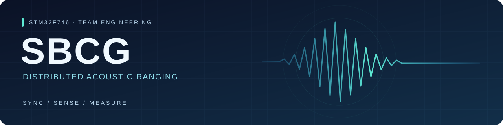

<p align="center">
  
</p>

<p align="center">
  <strong>双节点协同 · 硬件时间同步 · 声音到达时间差 · 统一温度补偿</strong>
</p>

<p align="center">
  
  
  
  <a href="https://github.com/jxq1231/SBCG/actions/workflows/host-checks.yml"></a>
</p>

<p align="center">
  <a href="#快速开始">快速开始</a> ·
  <a href="#项目进度">项目进度</a> ·
  <a href="#文档导航">文档导航</a> ·
  <a href="CONTRIBUTING.md">协作指南</a> ·
  <a href="https://github.com/jxq1231/SBCG/issues">任务与讨论</a>
</p>

## 项目介绍

SBCG是基于两块 **STM32F746G-DISCO** 的分布式声波测距课程项目。目标是在板端完成以太网时间同步、声音事件采集、到达时间差计算和温度补偿，并在两块板上显示一致的测量结果。

这个仓库用于共享工程、审核硬件资源、跟踪实验结果和协作开发。**以下架构描述为设计目标，单板LwIP基本ping、逐秒单向UDP及电脑请求/板端应答已验收；两板通信、时间同步及测距业务尚未实现。**

| 设计方向 | 团队约定 |
| --- | --- |
| 时间同步 | ETH IEEE1588硬件时间为唯一测量时间源，A主/B从 |
| PPS观测 | TIM2仅执行PTP整秒脉冲输出，计划使用PA15，不另建测量时钟 |
| 声音测量 | 后续通过SAI/DMA采集声音事件，以统一时间计算TDOA |
| 温度补偿 | A板读取一只DHT11，经UDP共享温度快照；两端使用同一整数公式 |
| 显示 | LTDC、帧缓冲、DMA2D和绘图数据统一RGB565 |
| 双板身份 | 同一固件根据真实MCU UID固定分配A/B角色 |

> 测距布置和声源位置决定TDOA对应的物理含义，详见[硬件资源与测量约定](Docs/Hardware_Resources.md)。电脑用于开发、观察和设参，最终测量在板端完成。

## 项目进度

**最新主机增量M2.2.3已通过：将已验收的30组真实四时刻交给原C估算器，逐条返回OK；42项新增与原177项回归共219项检查、两配置构建/布局和独立复核通过。固件、加载内容及原始日志均保持不变，未烧录或访问硬件，仍为LOCAL/SYNC=0。** 见[结果、限制与复验](Docs/Milestones/M2_2_Sync_Observation.md)。

**当前板端基线M2.2.2单板UDP时间戳回报通过实物验收：新5007/6007服务以会话键关联请求RX及ACK TX硬件时间，电脑保存来源明确的四时刻样本。SBCG-M2.2-IO经授权烧录校验，30组新样本与原30组RX/TX/ACK全部匹配；70包零缺口、90条PTP/心跳连续，错误及溢出0。177项主机检查、两配置构建/布局、444文件实际再生成及复核亦通过；仍为LOCAL/SYNC=0，未校时或检查第二板。** 见[协议](Docs/Protocol.md)和[本轮记录](Docs/Milestones/M2_2_Time_Exchange.md)。

**此前M2.2.1已完成四时间戳估算器的纯算法验收：13组、1044次真实函数调用（含1000物理模型）验证偏差符号、路径时延和边界；原109项回归、两配置构建/布局及只读复核通过。函数尚未接入App运行，Debug/Release ELF及加载内容与板端基线完全一致，本轮未烧录、未校时。** 见[M2.2.1结果与边界](Docs/Milestones/M2_2_Sync_Estimator.md)。

**截至2026-10-20：M2.1.3单板RX/TX硬件时间戳关联通过实物验收。SBCG-M2.1-TX经授权烧录、校验和复位，30个电脑请求各匹配唯一DMA接收时间、发送时间及ACK；70个UDP包零缺口，91条PTP状态/心跳连续，错误及溢出0。109项主机检查、Debug/Release构建/布局、实际Generate Code回归及复核通过。时钟仍为LOCAL/SYNC=0，两板同步和整机测距尚未实现；当前不检查第二板。** 见[M2.1.3实测与复验](Docs/Milestones/M2_1_PTP_TX.md)。下述旧版本结果各自保留，不直接充当新版本证据。

| 内容 | 状态 | 入口 |
| --- | --- | --- |
| 工程与工具链 | STM32F746NGH6 / TFBGA216，CubeMX 6.18.1，CubeF7 V1.17.4 | [工程配置](SBCG.ioc) |
| 主机开发工作流 | 环境检查、Debug/Release构建、日志报告、地址定位已完成 | [操作指南](Docs/Development_Workflow.md) |
| M0.2串口观测 | 启动信息/每秒心跳代码、5项主机行为测试和Debug构建通过；用户已提供BOOT及21条心跳，板端发送通过 | [SerialWeb使用与配置核对](Docs/SerialWeb.md) |
| M0.1系统时钟 | 200 MHz / HSE Bypass，**当前单板调试复位启动通过** | [实物报告](Docs/Milestones/M0_1_Startup.md) |
| 两板UID与角色 | 已读当前单板真实UID；第二板及A/B指定待补录 | [当前状态](Docs/Project_State.md) |
| M1.1以太网物理链路 | 用户日志确认PHY地址0、ID=0007/C131、100 Mbps全双工，DOWN→UP→DOWN→UP；最后一段98条心跳正常 | [实物验收](Docs/Milestones/M1_1_Ethernet_Setup.md#10-用户实物日志验收结果) |
| M1.2 LwIP集成 | SBCG-M1.2-INT启动、12条连续心跳、100 Mbps全双工及ping 4/4回复通过；该版本无UDP应用 | [集成与实物验收](Docs/Milestones/M1_2_UDP_Setup.md#8-用户实物验收2026-10-19) |
| M1.2 单向UDP | 正常窗口31包零缺口；两组各两次拔插均恢复，最新一组已联合核对PHY、心跳与14个本地跳过时隙；序号/tick延续 | [实物结果与复验](Docs/Milestones/M1_2_UDP_Send.md#第二组拔插与串口联合验收2026-10-19) |
| M1.3 请求/应答 | 电脑30发30收，来源/UID/序号/请求标记匹配；串口VALID=30、ACK_OK=30，心跳连续，错误项均0；71项主机检查通过 | [实物结果与复验](Docs/Milestones/M1_3_UDP_Request_Reply.md#用户实物验收2026-10-20) |
| M1.4 双向UDP恢复 | 两次PHY断开后均恢复；41个匹配应答、19次断线窗口超时；5005的19个缺口与本地跳过对应，90条心跳连续 | [自动采集联合验收](Docs/Milestones/M1_4_UDP_Reconnect.md) |
| M2.1.1 本地PTP时钟 | 88条LOCAL/SYNC=0单调时间；本版本UDP 70包零缺口、30/30应答；已授权烧录校验 | [代码、再生成与实物验收](Docs/Milestones/M2_1_PTP_Clock.md) |
| M2.1.2 RX事件关联 | 30个请求各匹配唯一DMA时间及ACK，70包零缺口，98条PTP/心跳连续；错误/溢出0 | [实物结果与复验](Docs/Milestones/M2_1_PTP_RX.md) |
| M2.1.3 TX事件关联 | 本版本30组唯一RX/TX/ACK，70包零缺口，91条PTP/心跳；错误/溢出0 | [实物结果与复验](Docs/Milestones/M2_1_PTP_TX.md) |
| M2.2.3 真实样本估算链 | 归档30组均由原C返回OK；219项检查通过，固件和原始数据不变 | [主机回放验证](Docs/Milestones/M2_2_Sync_Observation.md) |
| M2.2.2 时间戳数据链 | 30组新样本、原30组RX/TX/ACK、70包零缺口、90条PTP/心跳；本版本实物验收通过 | [实现及验收记录](Docs/Milestones/M2_2_Time_Exchange.md) |
| M2.2.1 估算数学内核 | 13组/1044次调用、含1000物理模型；未接入运行或校时，加载内容保持不变 | [纯算法结果与复验](Docs/Milestones/M2_2_Sync_Estimator.md) |
| 显示 / 同步 / 音频 / 测距 | 资源约定已记录，功能尚未实现 | [资源规划](Docs/Hardware_Resources.md) |

完整要求及实施顺序见[任务书路线与验收矩阵](Docs/Project_Roadmap.md)，当前实测范围见[项目状态](Docs/Project_State.md)。路线优先建立观测、网络与统一时间，再完成声音检测、测距和基础LCD；基础60分闭环后推进提高功能。所有文档从[Docs入口](Docs/README.md)阅读。

| 里程碑 | 验收目标 | 当前状态 |
| --- | --- | --- |
| M0 | 资源规划与系统基线 | 本板启动通过；M0.2启动/心跳发送已通过用户实物日志验收；MCU接收未实现 |
| M1 | 以太网链路与双向UDP通信 | 本板与电脑正常请求/应答、两次链路恢复及5005接收已验证；两板UDP未实现 |
| M2 | 时间同步及PPS精度验证 | 本地时钟、RX/TX及单板UDP时间戳回报通过；估算器纯算法通过，两板同步及PPS待实现 |
| M3 | 音频DMA采集 | 未开始 |
| M4 | 声音事件检测 | 未开始 |
| M5 | TDOA测量及标定 | 未开始 |
| M6 / M7 | 课程基础 / 提高要求验收 | 未开始 |

## 快速开始

### 1. 获取工程

```powershell
git clone https://github.com/jxq1231/SBCG.git
cd SBCG
```

审阅连接/构建诊断修复与最新单板启动记录时，另外执行：

```powershell
git switch --track origin/jxq/m0-clock-review
```

### 2. 准备开发环境

安装Git、Python 3.9及以上、CMake、Ninja和ARM GNU Toolchain。编辑器使用VS Code，并按仓库推荐安装扩展。需要生成硬件配置时使用团队约定的CubeMX 6.18.1 / CubeF7 V1.17.4；烧录调试需要OpenOCD与ST-LINK。

当前VS Code设置中含有维护者机器上的GDB、OpenOCD、clangd和编译器路径，队友首次使用须按本机安装位置调整；不要直接覆盖其他成员的工具设置。具体见[协作指南](CONTRIBUTING.md#本机工具配置)。

### 3. 检查与构建

在工程根目录执行：

```powershell
python -B Tools/Monitor/autodebug.py doctor
python -B Tools/Monitor/autodebug.py build
python -B -m unittest discover -s Tools/Monitor/tests -v
```

VS Code中，`Ctrl+Shift+B`运行默认Debug构建；“运行任务 → STM32: AI Debug”会构建并保存诊断报告。报告位于`Logs/AutoDebug/`，不提交到Git。

**构建成功只代表编译和链接通过。** 烧录、实物启动、同步精度和最终测距均需单独记录结果。GitHub的Host checks仅运行主机工具测试，不连接开发板。

## 文档导航

| 文档 | 内容 |
| --- | --- |
| [Docs入口](Docs/README.md) | 阅读顺序、资料依据与已验证/目标配置的区别 |
| [Project State](Docs/Project_State.md) | 当前分支、已完成事项、待验收项目和下一步 |
| [Project Roadmap](Docs/Project_Roadmap.md) | 任务书基础/提高指标、全部开发步骤、误差预算与验收方法 |
| [CubeMX Step 1](Docs/CubeMX_Step1.md) | SYS/RCC配置、200 MHz基线及启动验收步骤 |
| [Single-board Startup](Docs/Milestones/M0_1_Startup.md) | ELF与Flash比对、时钟寄存器、主循环、HAL时基及单板验收范围 |
| [Hardware Resources](Docs/Hardware_Resources.md) | 引脚、时钟、DMA、显示、同步、温度和测距约定 |
| [Development Workflow](Docs/Development_Workflow.md) | VS Code入口、主机诊断工具、退出码和日志 |
| [USART1 / SerialWeb](Docs/SerialWeb.md) | 串口配置审查、指定网页工具、COM口及收发验收边界 |
| [Contributing](CONTRIBUTING.md) | 分支、提交、PR、CubeMX所有权及实验记录要求 |
| [Project Rules](AGENTS.md) | 工程修改、生成代码保护和验证提交规则 |

## 仓库结构

```text
SBCG/
├── App/                  应用调度、串口与PHY资源抽象
├── Core/                 CubeMX生成的应用入口与中断代码
├── Drivers/              HAL与CMSIS依赖
├── LWIP/                 CubeMX生成的网络接口与协议栈配置
├── Middlewares/          随工程生成的LwIP第三方源码
├── cmake/                现有交叉编译及CubeMX构建集成
├── Tools/Monitor/        主机环境检查、构建诊断与地址定位
├── Docs/                 资源约定、项目状态与操作指南
├── .vscode/              构建、烧录、调试和语言服务配置
├── .github/              首页素材、协作模板与主机测试
└── SBCG.ioc              CubeMX硬件配置源
```

`build/`、`Logs/`和`compile_commands.json`为本机生成内容。`App/`已有应用调度、串口和PHY监视模块；后续只按当前里程碑需要扩展。

## 一起开发

1. 先在[Issues](https://github.com/jxq1231/SBCG/issues)说明本次目标、资源影响和验收方法。
2. 从最新`master`创建一个职责明确的分支，使用`jxq/<topic>`命名；成员可由团队另行约定自己的前缀。
3. 每次推进一个独立可测试增量，提交后发起PR，并写明编译、烧录和实物验证分别进行到哪一步。
4. `.ioc`、主PLL、TIM2、DMA、NVIC等共享资源变更先沟通，再通过CubeMX生成；不手改生成硬件配置。
5. 用Issue记录问题、PR讨论代码、`Docs/`保存可复核结论。尚未验收的硬件快照保持草稿PR状态。

完整约定见[协作指南](CONTRIBUTING.md)。团队成员的模块负责人和真实UID尚未填写，不在仓库中预设分工或虚构设备数据。

## 第三方代码

`Drivers/`中的HAL/CMSIS代码及其他ST生成内容遵循各文件和目录中的许可说明。仓库尚未为自有代码指定统一开源许可证；协作共享不等于重新授权第三方代码。
